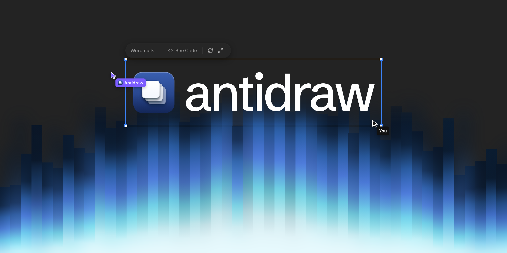

<p align="center">
  <a href="https://antidraw.com">
    
  </a>
</p>

<h3 align="center">product design & prototyping canvas for your coding agents, powered by real code.</h3>

<p align="center">
  <a href="https://github.com/AntidrawHQ/antidraw/releases/latest/download/Antidraw-arm64.dmg"><b>Download for Apple Silicon</b></a>
  ·
  <a href="https://github.com/AntidrawHQ/antidraw/releases">All releases</a>
  ·
  <a href="https://antidraw.com">antidraw.com</a>
  ·
  <a href="https://github.com/AntidrawHQ/antidraw/issues">Issues</a>
</p>

---

Antidraw is a design canvas for your coding agents. Describe what you want and it appears on a Figma-like canvas, where every frame is real React code: components that actually work, built from the libraries and design systems your team already uses, ready to hand to your developer as they are.

It runs on your machine, not somewhere in the cloud. Antidraw runs Claude Code locally, with your own Claude account.

## bring your favourite component library.

shadcn/ui, Radix, Ark UI, React Aria, Mantine, Material UI. Install it, ask for it, and it's on the canvas, working.

| | | |
|---|---|---|
| shadcn/ui | Radix | Ark UI |
| React Aria | Mantine | Material UI |
| Chakra UI | HeroUI | Motion |
| Magic UI | Recharts | Remotion |
| React Three Fiber | ElevenLabs UI | Workday Canvas |
| Supabase UI | Clerk Components | React Email |

…and anything else on npm.

## build like your favourite companies, with their own components.

Kumo from Cloudflare, Fluent from Microsoft, Polaris from Shopify, Primer from GitHub. Or your company's own, from a private registry.

| | | |
|---|---|---|
| Kumo · Cloudflare | Fluent UI · Microsoft | Polaris · Shopify |
| Primer · GitHub | React Spectrum · Adobe | Ant Design · Ant Group |
| Carbon · IBM | Atlassian Design System | Lightning · Salesforce |
| Base Web · Uber | Gestalt · Pinterest | Paste · Twilio |
| EUI · Elastic | | |

## bring any library to the canvas. make and iterate on anything.

There's no list of supported libraries. If it's on npm, your agent installs it and builds with it, right on the canvas. Use Motion to build micro-interactions, Remotion for video, React Three Fiber for 3D.

## made for the whole team, everyone with an idea to show.

PMs, designers, marketers and sales spend their days describing products to each other. With Antidraw they can show it, working.

### For PMs

Make prototypes and wireframes people can actually use and share. Explore directions until you find the right one, at AI-native speed.

- **Several takes on one PRD.** Hand it the PRD and ask for three takes. Each one is built from the components your team already ships, so every option on the table is one engineering could actually build.
- **Real flows you can click through.** Screens that link up, with the transitions, loading states and small interactions in place. Walk a stakeholder through the real thing instead of narrating a slide.
- **Real data, real logic.** Drop in a spreadsheet or a sample of real data, and give the prototype logic a picture can't fake: sorting, filtering, search, totals, pricing maths. Your numbers and edge cases, not lorem ipsum.
- **Test it with users.** Run research sessions on a prototype that behaves like the product. Testers click through the real flow while you watch, and you can change it between sessions.

### For designers

Design in the material the product is made of.

- **Animations other tools can't do.** Springs, gestures, scroll, drag and physics you can actually feel, not a prototype link that fakes it with dissolves. Tune the motion on the real component until it's right.
- **Build the controls you need.** Ask for the exact sliders, swatches and toggles a design needs, then shape it by hand. When AI can make almost anything, the craft is in having the right handles.
- **Design every state.** Hover, loading, empty, error, the 40-character name and the three-line title. Flip through them on the real component instead of drawing each one.
- **Responsive for real.** Resize the frame and the layout reflows the way it will in the browser. No more drawing a mobile, tablet and desktop copy of every screen.

### For marketers

On-brand assets from the real product, with every detail yours to adjust.

- **Launch videos with Remotion.** Feature announcements made from your real components and brand, scene by scene. The product in the video is the product people get, and every frame is yours to adjust.
- **Slides made of real components.** Launch keynotes and webinar decks built from your actual product and brand. Animated where you want it, and never out of date with the app.
- **Every size, from one design.** Because it's code, one design adapts. Ask for the square, the story and the banner, and each one lays itself out properly instead of being redrawn.

### For sales

Show prospects the product they're buying, shaped around them.

- **Mockups with their data.** Their logo, their colours and their records, inside your product. Show a prospect what it looks like when it's theirs, before they've signed anything.

## start on the canvas.

Free and open source, now in alpha, for Macs with Apple Silicon or Intel. It runs Claude Code on your machine, with your own Claude account.

### Install

- **Apple Silicon:** [download `Antidraw-arm64.dmg`](https://github.com/AntidrawHQ/antidraw/releases/latest/download/Antidraw-arm64.dmg)
- **Intel:** download the `x64` `.dmg` from [Releases](https://github.com/AntidrawHQ/antidraw/releases)

Drag Antidraw to `/Applications`. Builds are signed and notarized, so the first launch works without any Gatekeeper workarounds. Updates arrive automatically via `electron-updater` from the GitHub Releases feed.

### Status

Early alpha. macOS only. Expect rough edges, and please [open an issue](https://github.com/AntidrawHQ/antidraw/issues) when you hit one.

## Development

Requires Node 20+ and npm.

```sh
git clone https://github.com/AntidrawHQ/antidraw
cd antidraw
npm install
npm run dev:shell
```

That launches the Electron shell in dev mode with HMR. `npm run dev:server`
runs the cloud Worker locally instead (see `packages/server/README.md`).

To produce an installable build:

```sh
npm run build:unpack -w @antidraw/shell    # unpacked .app at packages/shell/release/<version>/mac-<arch>/
npm run build:mac    -w @antidraw/shell    # full DMG (host arch)
```

Releases are cut by pushing a `v*.*.*` tag — the workflow in `.github/workflows/release.yml` builds, signs, and notarizes both arches, then uploads a draft release. Promote the draft to "published" when ready; `electron-updater` only picks up published releases.

## Project layout

```
packages/
  shell/              Electron app (main + preload + renderer)
  plugin-runtime/     Runtime imported by user workspaces
  create-workspace/   `npm create @antidrawapp/create-workspace` scaffolder
  server/             Cloudflare Worker cloud API (Hono + D1)
  website/            antidraw.com, built with Astro
  share-page/         The share page at antidraw.com/s/<slug>
  site-worker/        Serves published sites at <slug>.antidraw.app from R2
  site-upload/        Content-addressed static-site uploads to R2
```

The shell is the actual app. `server` is the network-exposed cloud API that
gates publish/sync — distinct from the shell's in-Electron API, which is not
network-exposed. `create-workspace` and `plugin-runtime` are the npm packages
users consume from their own design workspaces.

## License

[MIT](LICENSE).
